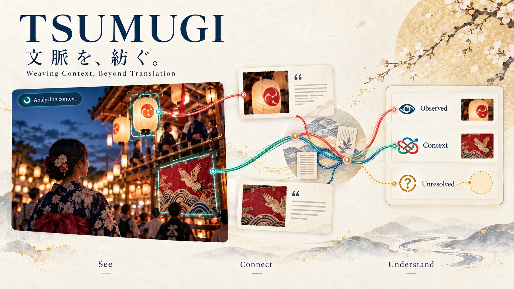
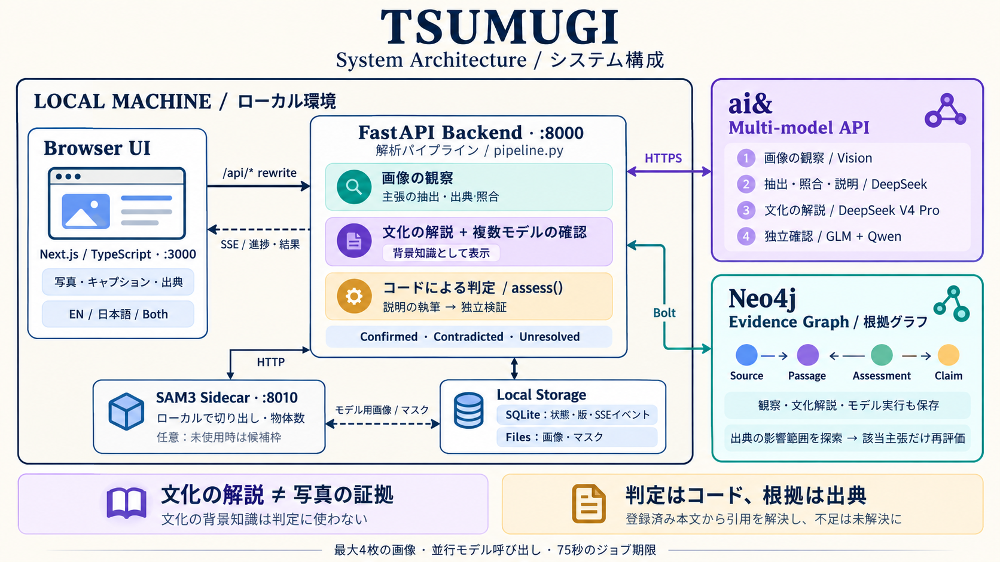

<p align="center"></p>

# TSUMUGI — Weaving context, beyond translation

**English** · [日本語](README.ja.md)

TSUMUGI (紡ぐ, "to weave") is a cultural field guide for people who love Japan. It separates **what a photograph shows** from **what its caption claims**, and tells you what is established, what is only context, and what is still unresolved.

Upload up to four images and a caption. The app walks through three steps:

1. **See**: models describe what is visibly there and outline the regions (VLM boxes refined into SAM3 masks).
2. **Connect**: each claim in the caption is linked to the observations and checked against the sources you register.
3. **Understand**: every claim is shown as confirmed, contradicted or unresolved, with its cited passage. Add or disable evidence to see the explanations change, and follow every result through an evidence graph in Neo4j. Cultural background notes sit beside the result, clearly marked as background, not evidence.

Every item is shown in English and Japanese (switch between EN, 日本語 and Both).

## Start locally

Requires Node.js 22+, Python 3.9+, an ai& API key with credits, and a reachable Neo4j database.

```sh
npm install
python3 -m venv .venv
.venv/bin/pip install -r backend/requirements.txt
cp .env.example .env  # only for a new installation; preserve an existing .env
```

Set the ai& and Neo4j variables in `.env`. The backend automatically loads this file. Never put credentials in `NEXT_PUBLIC_*` variables. Start and stop both servers with one command:

```sh
npm run up       # backend + production frontend (no development overlay); waits until both respond
npm run up:dev   # backend + next dev with hot reload
npm run status   # show what is running
npm run logs     # follow .runtime/logs/backend.log and frontend.log
npm run down     # stop both, including this project's servers started by hand
```

### Optional: local SAM3 segmentation

SAM3 (`facebook/sam3`, gated on Hugging Face) turns the VLM's candidate boxes into pixel masks. It runs as a separate local process because it needs Python 3.10+ with PyTorch, while the backend's `.venv` stays as it is:

```sh
uv venv ~/models/sam3/.venv --python 3.12
uv pip install --python ~/models/sam3/.venv/bin/python torch torchvision transformers huggingface_hub pillow
~/models/sam3/.venv/bin/hf download facebook/sam3 --exclude sam3.pt --local-dir ~/models/sam3/facebook-sam3
```

Then set `SAM3_PYTHON=~/models/sam3/.venv/bin/python` and `SAM3_MODEL_DIR=~/models/sam3/facebook-sam3` (absolute paths) in `.env`. `npm run up` starts the sidecar on port 8010 (`SAM3_PORT`), waits for the model to load, and passes `SAM3_URL` to the backend; `npm run status` and `npm run down` include it. Without these variables, or if the sidecar fails to start, the app keeps the VLM boxes as before.

Open http://127.0.0.1:3000. `BACKEND_PORT` and `FRONTEND_PORT` override the default ports 8000 and 3000. `npm run down` only stops processes running from this directory; another app on the same port is left alone. To run the servers separately instead, use `npm run backend` with `npm run dev` (or `npm run demo`) in two terminals; set `TSUMUGI_BACKEND_URL` if the backend is not on port 8000. Both servers bind to loopback. Use one backend process; there is no multi-worker job queue or public authentication.

## 90-second walkthrough

1. Select **Try an example** (two photographs and a caption), then **Explore the context**. Observations and claims appear as each model call finishes.
2. Switch between **Image 1** and **Image 2**. Select a claim: its candidate image regions are highlighted on every image, with a count on each thumbnail.
3. Select **Add evidence → Use the Kyoto tourism excerpt → Add & re-evaluate**.
4. Inspect **What changed**: the July festival claim gains support; both photographs' place and 2026 date remain unresolved. Explanations show **Independent check · qwen**.
5. Open **Graph**, select nodes to see their neighbours, then hover **Disable** on the source to highlight what it affects. Disable it to withdraw its support.

The caption is synthetic. Image 1 is licensed CC BY 2.0 by Ippei Suzuki; image 2 is a public-domain 1905 album photograph by E. G. Stillman (Harvard, via Wikimedia Commons). Credits and source links appear in the UI; their attribution metadata (including the 1905 date) is not submitted as evidence, and the handwritten "GION FESTIVAL IN KIOTO" on the mount is treated as visible content only. The source fixture contains short excerpts from Kyoto City's tourism FAQ.

Further documents (Japanese): [docs/ARCHITECTURE.md](docs/ARCHITECTURE.md) (architecture), [docs/DEMO.md](docs/DEMO.md) (presenter script with timings, talking points and fallbacks), [docs/TSUMUGI_Design_v1.md](docs/TSUMUGI_Design_v1.md) (the original pre-implementation design, kept as history).

## Architecture and behavior

<p align="center"></p>

The full architecture (in Japanese) is in [docs/ARCHITECTURE.md](docs/ARCHITECTURE.md). In short:

- **Models propose, code decides.** Verdicts come from `assess` in `backend/pipeline.py`, using only registered source text. Model-chosen passage IDs must resolve to saved text, and place/time mismatches, conflicting evidence and photograph-identity claims stay unresolved.
- **Concurrent pipeline** (at most 8 ai& calls at a time, 75-second job deadline): per-image observation and claim extraction start together, verification starts once claims exist, and each claim runs its own write → independent check (`AIAND_CHECK_MODEL`) pipeline. A caption with nothing checkable still gets its images described.
- **Images** are stored upright (EXIF orientation applied once) so the page, VLM boxes and SAM3 masks share the same pixels; only metadata-stripped, resized copies go to the models. With SAM3, each observation's short label is the text prompt, instances mostly inside the VLM box are merged into a mask, and an empty result is asked again in simpler words (`SEG_MISSED` if it stays empty). Masks are waited for at most 25 seconds and never past 60 seconds into the job. `Region` records the SAM3 `prompt`, `segmenter`, `mask_score`, `instance_count` and `mask_area`.
- **Cultural background**: a writer model and independent reviewers (`AIAND_CULTURE_MODEL`, `AIAND_REVIEW_MODELS`) produce `CulturalNote` items marked agreed, disputed or unchecked. They are background from model knowledge, never evidence, and never touch a verdict.
- **Storage**: SQLite in ignored `.runtime/` holds inputs, snapshots, SSE events and idempotency records; Neo4j holds each revision (`v2:` keys, typed labels and relationships) in two batched statements. Failed graph writes are replayed at startup; a failed revision keeps the previous verified display, and an interrupted job becomes failed and can be retried.
- **Frontend**: the UI follows the job over SSE and ignores events from a previous analysis. **New analysis** clears the photos and caption as well as the results.
- **Not implemented**: public deployment, photo-provenance verification and URL fetching (sources are registered text). One job runs at a time per process.

## Checks

```sh
npm test                  # deterministic constraints/API/graph tests, no paid calls
npm run build             # production build + TypeScript
.venv/bin/python scripts/check_models.py  # live vision/JSON probes and the independent checker; requires credits
.venv/bin/python scripts/smoke.py         # live 2 images → add → disable → graph/impact → SSE replay, with per-step timings
```

Live scripts send the public samples and synthetic caption to ai& and store versioned graph records in your configured Neo4j instance. Results and logs remain local; `smoke.py [label]` saves timings to `.runtime/smoke-timings-<label>.json`. The probe saves the successful vision model ID to `.env`.
