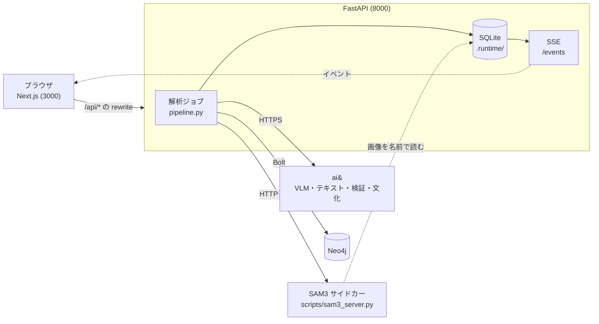
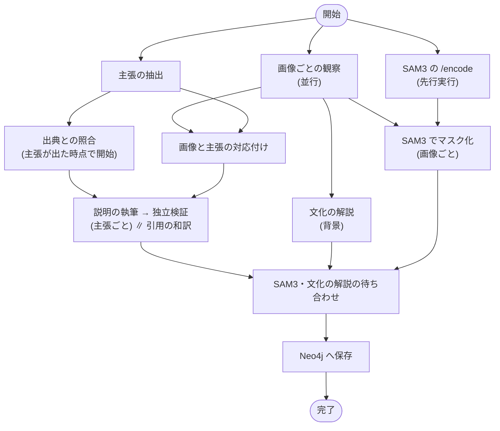

# TSUMUGI アーキテクチャ

現在の実装を正として、構成を1か所で追えるようにまとめた文書です。コードの場所は、行番号ではなくファイルと関数の名前で示します（行番号は古くなるため）。

- 起動と使い方：[README.md](../README.md)（英語）
- 発表の台本と実測値：[DEMO.md](DEMO.md)
- 実装前の設計案（履歴）：[TSUMUGI_Design_v1.md](TSUMUGI_Design_v1.md)。実装と違う点は、その冒頭の注記にまとめてあります。

## 1. 概要と原則

TSUMUGI は、写真が示すことと、キャプションが主張することを分けて見せる文化のガイドです。観察・主張・出典・文化的解釈を別々のものとして扱います。

- **モデルは判定を決めない。** 判定（`confirmed` / `contradicted` / `unresolved`）はコード（`pipeline.py` の `assess`）が、保存された出典の本文だけから決めます。モデルが書くのは、観察・主張の抽出・引用の候補・説明の文面です。
- **文化の解説は証拠ではない。** モデルの一般知識から書かれた背景で、判定には一切つなげません。
- **単一プロセス。** 1つのバックエンドで、同時に動く解析は1件です。公開デプロイ、認証、複数ワーカーのジョブキューはありません。
- **ループバック限定。** バックエンド、フロントエンド、SAM3 のサイドカーはすべて `127.0.0.1` に bind します。

## 2. 全体図

ブラウザは `next.config.ts` の rewrite（`/api/:path*` → `TSUMUGI_BACKEND_URL`、既定は `http://127.0.0.1:8000`）でバックエンドへ届きます。SAM3 のサイドカーは、バックエンドのデータディレクトリにある `*-model.jpg` を、ファイル名だけで読みます。

## 3. コンポーネントの責任

| 場所 | 責任 |
| --- | --- |
| `backend/main.py` | API のルート、ジョブの起動（`launch` / `run`）、入力の検証、EXIF の向きの補正（`upright_image`）、起動時の中断ジョブの失敗化とグラフの再送（`lifespan`）、失敗時に直前の検証済み表示へ戻す処理 |
| `backend/pipeline.py` | 解析の本体（`process` / `_process`）。並行処理、プロンプト、`assess` による判定、説明の執筆と独立検証、引用の和訳、定型文 |
| `backend/llm.py` | ai& の呼び出し（`call`）。JSON 出力、時間制限、再試行、ToolRun の記録 |
| `backend/segment.py` | SAM3 の呼び出し（`Job`）。`select`・`simplify`・`compose`、時間の予算 |
| `scripts/sam3_server.py` | SAM3 のサイドカー（`/health` `/encode` `/segment`）。画像の特徴量の LRU キャッシュ |
| `backend/culture.py` | 文化の解説。書き手と確認役の呼び出し、合意の規則（`consensus` / `combine`） |
| `backend/graph.py` | Neo4j への保存（`payload` / `write` / `persist` / `replay`）、読み出し（`read`）、影響範囲（`impact` / `local_impact`） |
| `backend/store.py` | SQLite の読み書きとイベントの採番、`.runtime/` の場所（`TSUMUGI_DATA_DIR`） |
| `app/page.tsx` | 画面全体。SSE の購読、解析の開始、出典の追加と切替、`reset()` |
| `app/culture.tsx` | 「文化の解説」の表示（合意の状態、確認役の訂正） |
| `app/spotlight.tsx` | 画像上の枠とマスクの表示（CSS の `mask-image`） |
| `app/summary.tsx` | 解析の要約と、モデル呼び出しの一覧（Activity） |
| `app/present.tsx` | 発表モード（大きな文字と太い線） |
| `app/i18n.tsx` | 英日の表示切替（EN / 日本語 / Both）。`Bi` と `pick` |
| `app/graph/*` | グラフの表示（`GraphView.tsx`、`model.ts`、`graph.css`） |
| `scripts/tsumugi.sh` | `npm run up / down / status / logs`。バックエンド、フロントエンド、設定があれば SAM3 を起動・停止する |

## 4. 解析パイプライン

初回（検証済みの表示がまだない）と、再評価（出典の追加・切替）の2つの経路があります。どちらも `pipeline.py` の `_process` が担当し、全体を `main.py` の `run` が 75 秒の期限で包みます。

再評価では、画像の観察と SAM3 は走らせません（観察とマスクは前回のまま）。出典を無効にした場合は、その出典から影響を受ける主張だけを再照合し、残りは検証済みの結果を再利用します（`reuse_unaffected` と `stale_claim_ids`）。文化の解説は、初回に一度だけ書き、再評価では書き直しません（`cultural_notes` が未設定のときだけ書く）。

### モデル呼び出しの一覧

| 呼び出し（`tool`） | 役割 | モデル | 時間制限 |
| --- | --- | --- | --- |
| Image observation · N | 画像ごとに最大3件の観察、枠、SAM3 用のラベル | `AIAND_VISION_MODEL` | 20秒、再試行1回 |
| Claim extraction | 最大8件の主張（`span` は入力本文の部分文字列） | `AIAND_MODEL` | 20秒、再試行1回 |
| Claim–observation linking | 主張と観察の対応の候補（読む手がかり。判定には使わない） | `AIAND_MODEL` | 20秒、再試行1回 |
| Evidence verification | 出典の本文から引用の候補を選ぶ（`passage_id` と `stance`） | `AIAND_MODEL` | 20秒、再試行1回 |
| Explanation writing · Cn | 判定の範囲内で説明を書く | `AIAND_MODEL` | 20秒、再試行1回 |
| Independent check · … · Cn | 説明の根拠と日本語訳の忠実さを別系統のモデルが確認 | `AIAND_CHECK_MODEL` | 8秒、再試行1回 |
| Quote translation | 引用の参考和訳（原文が正） | `AIAND_MODEL` | 20秒、再試行1回 |
| Cultural notes · writer | 文化の解説を最大4件書く | `AIAND_CULTURE_MODEL` | 30秒、再試行1回 |
| Cultural review · モデル名 | 解説を独立に確認する | `AIAND_REVIEW_MODELS` の各モデル | 10秒、再試行なし |
| Image segmentation · N | 枠をマスクに絞る | SAM3（`facebook/sam3`） | 各リクエスト 40秒（§6） |

- ai& への同時呼び出しは最大8件です（`pipeline.slots`）。
- ジョブ全体は 75 秒の期限です（`main.run`）。超えると失敗になります。
- 画像の観察、主張の抽出、SAM3 の `/encode` は同時に始まります。出典の照合は、主張が出た時点で、観察や対応付けを待たずに始まります。
- 画像の観察に失敗した画像は、画像の制限事項として記録し、文章の主張の評価は続けます。
- 主張が0件のキャプション（題名や単語だけ）でも、画像の観察と文化の解説は行い、制限事項 `NO_CLAIMS` を記録します。
- 主張の抽出に失敗すると、ジョブ全体が失敗します。

## 5. 判定の仕様

`assess` は、各主張について、モデルが選んだ引用を保存済みの出典と突き合わせ、次の順に規則を当てます。先に当てはまったものが `reason_code` になります。

| 順 | 条件 | `reason_code` | `status` |
| --- | --- | --- | --- |
| 1 | 引用が登録済みの出典の本文と一致しない | `invalid_citation` | `unresolved` |
| 2 | 主張の `kind` が `photo_identity` | `photo_provenance_missing` | `unresolved` |
| 3 | 主張の `kind` が `interpretation` | `interpretation` | `unresolved` |
| 4 | 範囲が合う引用に、支持と反証の両方がある | `conflicting_evidence` | `unresolved` |
| 5 | 範囲が合う引用に支持がある | `support_found` | `confirmed` |
| 6 | 範囲が合う引用に反証がある | `counterevidence_found` | `contradicted` |
| 7 | 引用はあるが、範囲が合うものがない | `scope_mismatch` | `unresolved` |
| — | 上のどれでもない | `insufficient_evidence` | `unresolved` |

- **引用の解決。** モデルは `passage_id` を選ぶだけで、引用文は書きません。サーバーが、その ID を保存された出典のテキストから解決します（`pipeline._process` の `verify`）。存在しない ID は `source_id='invalid'` となり、`invalid_citation` になります。
- **範囲の不一致。** 主張と出典の `place`・`time_start`・`time_end` がどちらにもあって、大文字小文字を無視して違えば、`scope_match` を偽にします。モデルが `scope_match` を偽と返した場合も同じです。偽の引用は、判定の支持や反証に数えません。
- **定型文。** `invalid_citation`、`photo_provenance_missing`、`conflicting_evidence`、`scope_mismatch` の理由は、コードが固定の英日の文を使います。それ以外はモデルの `reason` を使い、なければ既定の文になります。
- **説明。** 説明はモデルが書き、別系統のモデルが「根拠に沿っているか」「日本語が忠実か」を確認します。承認されなければ（確認役の停止を含む）、固定の文面（`fallback`）を使います。

## 6. 画像の処理

### 保存

`main.create` が、受け取った画像を次のように保存します。

- EXIF の向きが付いている画像は、一度だけ正立に直して保存します（`upright_image`）。ブラウザは向きを反映しますが、モデルは反映しないため、ページ・VLM の枠・SAM3 のマスクが同じピクセルを指すようにするためです。
- 保存するのは、正立にした元画像（`{id}-{n}.jpg|png`）と、メタデータを除いて最大 1600px に縮めたモデル用の `{id}-{n}-model.jpg` です。外部のモデルへ送るのは後者だけです。

### SAM3（任意）

`SAM3_URL` が設定されているときだけ動きます。未設定、またはサイドカーが落ちていれば、VLM の枠をそのまま使います。

1. ジョブの開始と同時に、全画像へ `/encode` を送ります（画像の特徴量の計算が重いので先行）。
2. 画像の観察が返ると、各観察の `label`（例：`paper lantern`）を、枠付きの観察ごとに `/segment` へ送ります。
3. `select`：`score ≥ 0.5` で、SAM3 の枠の面積の半分以上が VLM の候補の枠の内側にある例だけを残します。
4. 空だった観察は、`simplify` で名詞に短くした言葉（`people pulling ropes` → `people`、`person on roof` → `person`）で、1回だけ聞き直します。特徴量はサイドカーが持っているので、デコードだけで済みます。
5. `compose`：残った例を1枚のアルファ PNG に合成し、`mask` と `area` を観察に記録します。producer は `SAM3 mask from VLM candidate` になります。
6. 待ち時間は、`DEADLINE=60`（ジョブの開始から60秒まで）かつ `CAP=25`（最大25秒）の小さい方です。残りは枠だけにします。

制限事項の記録は次の2つです。

- `SEG_FAILED`：サイドカーの失敗、または待ち時間の超過。その画像は枠だけ。
- `SEG_MISSED`：聞き直しても一致する物体が見つからない観察がある。その観察は枠だけ。

サイドカー（`sam3_server.py`）は、モデルを1つの加速器で順番に使い（ロック）、特徴量を `(ファイル名, 更新時刻)` をキーに LRU でキャッシュします（既定8件、`--cache`）。受け付ける画像名は `-model.jpg` で終わる単純なファイル名だけで、任意のパスは読みません。再評価ではセグメントし直しません。

## 7. 文化の解説

`culture.write` が、初回に1回だけ書きます（`explain_culture`。画像の観察が終わった後の背景処理）。

1. **書き手**（`AIAND_CULTURE_MODEL`）が、観察とキャプションの主張から、日本の文化的な事柄を最大4件選び、用語・読み・要約・要点・注意書きを書きます。写真の場所や時期の断定、人物の特定、キャプションの主張を真とすることは禁じています。
2. **確認役**（`AIAND_REVIEW_MODELS`、既定は2モデル）が、並行して各項目を `agree` / `disagree` / `unsure` で確認します。確認役の失敗は、その確認役を「回答なし」として扱います。
3. **合意の規則**（`consensus`）：書き手を1票として数えます。
   - 回答した確認役が0 → `unchecked`
   - `disagree` の数 × 2 > 回答数 → その項目を除外（要約が除外されると、その解説ごと除外。要点は1つずつ判定）
   - 全員が `agree` → `agreed`
   - それ以外 → `disputed`（確認役の訂正を付ける）
4. 解説の全体の状態は、項目の状態から決めます（すべて `unchecked` なら `unchecked`、すべて `agreed` なら `agreed`、それ以外は `disputed`）。

固定の注記（`NOTE`）が「複数の AI による一般的な背景知識であり、この写真の証拠ではない」と明示します。書き手が失敗した場合は `culture.FAILED` を画像の制限事項に記録し、解説は空になります。

**判定へは一切つなげません。** `assess` は文化の解説を見ません。Neo4j でも、`CulturalNote` に付く関係は `ABOUT`（観察へ）・`GENERATED_BY`（書き手の ToolRun）・`REVIEWED_BY`（確認役の ToolRun。`verdict` と `model_id` を持つ）だけです。

## 8. データ

### SQLite（`.runtime/tsumugi.sqlite`）

| テーブル | 内容 |
| --- | --- |
| `analyses` | 解析の現在の状態（JSON） |
| `snapshots` | 完了した版ごとの状態（`analysis_id`, `revision`） |
| `events` | SSE のイベント（`event_id` は解析ごとの連番） |
| `mutations` | Neo4j への書き込みの控え（`done` が 0 なら未反映） |
| `idempotency` | 出典の追加の `Idempotency-Key` と、その応答 |

### `.runtime/` のファイル

`tsumugi.sqlite`、画像（`{id}-{n}.jpg|png`）、モデル用の画像（`{id}-{n}-model.jpg`）、マスク（`{id}-{観察ID}-mask.png`）、`logs/`（`tsumugi.sh` が使う）。場所は `TSUMUGI_DATA_DIR` で変えられます。git では無視されます。

### Neo4j

- ノードは共通の `:Tsumugi` ラベルに、種類のラベルを足します。キーは `v2:{analysis_id}:{revision}:{id}` です。
- ラベル：`Asset` `Region` `Observation` `Claim` `Scope` `Source` `Passage` `Assessment` `Explanation` `CulturalNote` `ToolRun`
- 関係：`HAS_REGION` `GROUNDS` `LINKED_TO` `HAS_SCOPE` `EVALUATES` `CITES` `HAS_PASSAGE` `BASED_ON` `ABOUT` `GENERATED_BY` `REVIEWED_BY`
- ラベルと関係の種類はパラメータにできないため、許可リストから組んだ `FOREACH` で、1版の全ノードを1文、全関係を1文で書きます（`write`、2文のバッチ）。許可リストにないものは `ValueError` です。
- 保存の流れ：`persist` が先に SQLite の `mutations` へ控えを書き、Neo4j へ書き、成功したら `done=1` にします。起動時の `replay` が、未反映の控えを書き直します（`version==2` のみ）。同じキーは `MERGE` なので、再実行しても重複しません。
- `Region` は `bbox_normalized`、`prompt`（SAM3 に使った言葉）、`segmenter`、`mask_score`、`instance_count`、`mask_area` を持ちます。
- 影響範囲：`Source → Passage ← CITES ― Assessment → Claim`、および `Explanation → Assessment` をたどります（`graph.impact`）。Neo4j に届かなければ、保存済みの版から同じ走査を行います（`local_impact`）。

## 9. API と SSE

すべて `/api` の下です。

| メソッドとパス | 内容 |
| --- | --- |
| `GET /api/health` | 状態と、設定されたモデル名、SAM3 の有無 |
| `POST /api/analyses` | 画像（1〜4枚）・本文・`locale` で解析を開始（202） |
| `GET /api/analyses/{aid}` | 解析の取得（`?revision=` で完了した版） |
| `GET /api/analyses/{aid}/assets/{asset}` | その解析に登録された画像だけを返す |
| `GET /api/analyses/{aid}/masks/{observation}` | その解析の観察に記録されたマスクだけを返す |
| `GET /api/analyses/{aid}/graph` | グラフ（Neo4j、失敗時はローカルの版から。`stored` に由来を記す） |
| `GET /api/analyses/{aid}/sources/{sid}/impact` | 出典の影響範囲 |
| `GET /api/analyses/{aid}/events` | SSE（`Last-Event-ID` または `?after=` で再開） |
| `POST /api/analyses/{aid}/sources` | 出典の追加（`Idempotency-Key` 必須、`expected_revision`） |
| `PATCH /api/analyses/{aid}/sources/{sid}` | 出典の有効・無効（`expected_revision`） |
| `POST /api/analyses/{aid}/retry` | 失敗した解析の再実行（`expected_revision`） |

- 実行中のジョブがあるときの開始・更新は `503`、`expected_revision` が合わないときは `409` です。
- **イベント名**：`analysis.started` / `analysis.completed`（`status` を持つ）、`tool.started` / `tool.completed` / `tool.failed`、`observations.ready`、`claims.ready`、`claims.linked`、`evidence.retrieved`、`culture.ready`、`regions.segmented`、`claim.assessed`、`explanation.updated`。
- **状態**：`running` → `completed`（制限事項なし）/ `partial`（制限事項あり）/ `failed`。
- **失敗時の扱い**：失敗した更新は、直前の検証済みの表示（観察・主張・判定・説明）へ戻します。成功したように見える説明で置き換えません。最初の解析が失敗した場合は、判定と説明を空にします。再起動で中断されたジョブは、起動時に `failed` にし、再試行できます。
- SSE は、`no-transform` を付けて、Next.js のプロキシが終了までまとめて保持しないようにしています。

## 10. フロントエンド

- Next.js / TypeScript。フォントはローカル配信です。`/api` は `next.config.ts` の rewrite でバックエンドへ送ります。
- **SSE の購読**（`page.tsx` の `subscribe`）：イベントを受けるたびに解析を取得し直して描画します。`currentId` に、いま見ている解析の ID を持ち、別の解析へ切り替えた後に届いた古いイベントは捨てます。版の古い応答も、`currentRevision` より新しいときだけ反映します。
- **New analysis**（`reset()`）：購読を閉じ、選んだ写真・キャプション・結果・グラフ・影響の情報をすべて消し、空の開始画面へ戻ります。前の写真とキャプションが次の解析に混ざらないためです。
- **発表モード**（`present.tsx`）：ヘッダーのボタン、`P` キー、`?present=1` で入り、ブラウザごとに記憶します。
- **表示言語**（`i18n.tsx`）：EN / 日本語 / Both。モデルは英日を同時に返し、日本語がなければ英語を表示して制限事項を記録します。引用は原文のままで、`quote_ja` は参考和訳として明示します。

## 11. 設定

`.env`（バックエンドが自動で読む）または環境変数。認証情報を `NEXT_PUBLIC_*` に入れてはいけません。

| 変数 | 内容 | 既定値 |
| --- | --- | --- |
| `AIAND_API_KEY` | ai& の API キー | なし（必須） |
| `AIAND_MODEL` | テキストのモデル | `deepseek-ai/deepseek-v4-flash` |
| `AIAND_VISION_MODEL` | 画像のモデル | `deepseek-ai/deepseek-v4.1-flash` |
| `AIAND_CHECK_MODEL` | 説明の独立検証 | `qwen/qwen3.8-27b` |
| `AIAND_CULTURE_MODEL` | 文化の解説の書き手 | `deepseek-ai/deepseek-v4-pro` |
| `AIAND_REVIEW_MODELS` | 文化の解説の確認役（カンマ区切り） | `zai-org/glm-5.3,qwen/qwen3.8-27b` |
| `NEO4J_URI` `NEO4J_USERNAME` `NEO4J_PASSWORD` | Neo4j の接続 | なし（未設定ならグラフはローカルの版から読む） |
| `NEO4J_DATABASE` | データベース名 | `neo4j` |
| `SAM3_PYTHON` `SAM3_MODEL_DIR` | `tsumugi.sh` がサイドカーを起動するための Python とモデルの場所 | なし（未設定ならサイドカーなし） |
| `SAM3_URL` | バックエンドが使うサイドカーの URL（`tsumugi.sh` が設定） | なし（空なら SAM3 を使わない） |
| `SAM3_PORT` | サイドカーのポート | `8010` |
| `TSUMUGI_DATA_DIR` | データの置き場所 | `.runtime/` |
| `BACKEND_PORT` / `FRONTEND_PORT` | `tsumugi.sh` のポート | `8000` / `3000` |
| `TSUMUGI_BACKEND_URL` | フロントの rewrite の宛先、`smoke.py` の宛先 | `http://127.0.0.1:8000` |

## 12. 制限と未実装

- 出典は登録したテキストです。URL の自動取得はしません。
- 公開デプロイと認証はありません。1つのプロセスで、同時に1ジョブだけ動きます。
- 写真の来歴検証はしません。写真の場所・日付に関する主張は、常に `unresolved` です。
- キャッシュは実装していません。ToolRun の `cached` は常に `false` です（再評価で再利用するのは、検証済みの判定・説明・引用の和訳・マスク・文化の解説）。
- 枠とマスクは候補です。SAM3 は、すでに枠のある観察だけを絞ります。
- 入力の上限：画像 4枚、1枚 10MB、25メガピクセル、JPEG と PNG のみ、本文 5000字、出典の本文 12000字、主張 8件、画像ごとの観察 3件、文化の解説 4件。

## 13. テストの地図

`npm test`（`.venv/bin/python -m pytest tests -q`）は、有料の呼び出しをしません。

| ファイル | 担当 |
| --- | --- |
| `tests/test_api.py` | 入力の検証、複数画像、向きの補正、画像の上限、他の解析の画像の拒否、版と冪等性、SSE の再開、失敗が完了にならないこと、マスクの配信 |
| `tests/test_pipeline.py` | 判定（T01〜T08）、日本語の欠落、画像の失敗、並行処理、再評価での再利用、独立検証、文化の解説の合意、主張0件、再試行 |
| `tests/test_segment.py` | `select` / `simplify` / `compose`、サイドカーの失敗と時間切れ、聞き直し、版をまたいだ再利用 |
| `tests/test_graph.py` | ラベルと関係の許可リスト、`LINKED_TO` と `GENERATED_BY`、文化の解説の関係、影響範囲、グラフの読み出しとローカルへの切替 |

実際のモデルを使う確認は次のとおりです（クレジットが必要）。

- `scripts/check_models.py`：画像と JSON のプローブ、独立検証のモデル
- `scripts/smoke.py`：画像2枚 → 出典の追加 → 無効化 → グラフと影響範囲 → SSE の再生。各段階の時間を `.runtime/` に保存
